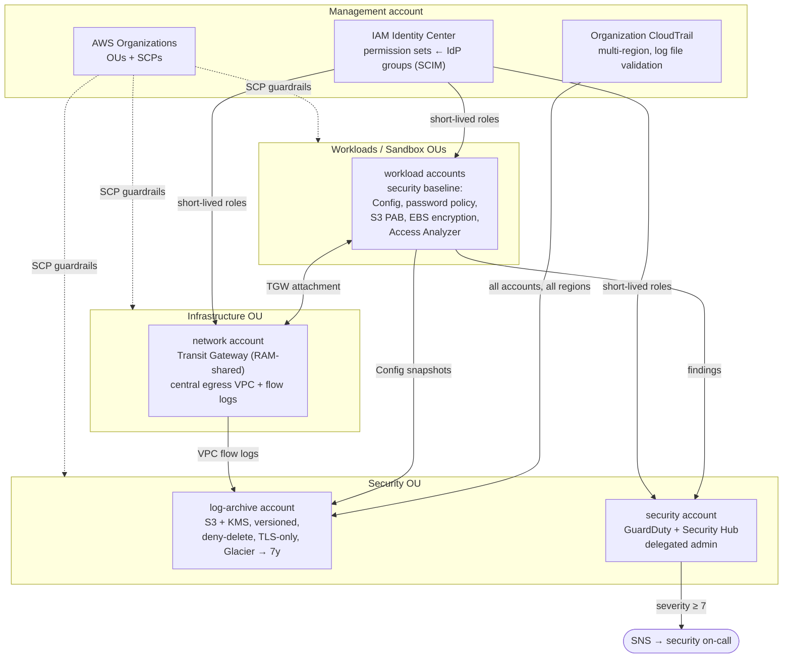

# AWS Multi-Account Landing Zone (Terraform)

An enterprise-style AWS landing zone in plain Terraform: an Organization with OUs and service control policies, a locked-down log archive account, an organization CloudTrail, AWS Config in every account, GuardDuty and Security Hub run from a delegated security account, a Transit Gateway network hub, and IAM Identity Center for workforce access.

> **Portfolio disclaimer:** sample/demo code inspired by my professional experience building multi-account AWS foundations for large enterprises and prior regulated AWS work (payments and healthcare). No client code, names, account IDs, or data. Account IDs in this repo are placeholders.

## Architecture



See [docs/account-layout.md](docs/account-layout.md) for the full OU tree and the account vending flow.

## Modules

| Module | Account | What it does |
|---|---|---|
| [`organization`](modules/organization) | management | Creates or adopts the Organization, trusted service access, OUs, SCPs (root and per-OU attachments), optional account vending. |
| [`log-archive`](modules/log-archive) | log-archive | KMS key with rotation and per-service grants; S3 bucket with BucketOwnerEnforced, public access block, versioning, SSE-KMS, lifecycle to Glacier, optional Object Lock; bucket policy that only allows **this org's** trail and Config to write (`aws:SourceArn`, `aws:SourceOrgID`) and denies deletes and non-TLS access. |
| [`org-cloudtrail`](modules/org-cloudtrail) | management | Organization, multi-region trail with log file validation and Insights; optional S3 data events for sensitive buckets; CloudWatch copy with CIS-style metric filters (root usage, console login without MFA, IAM policy changes, trail changes, security group changes). |
| [`security-baseline`](modules/security-baseline) | every member | IAM password policy, account alias, Access Analyzer, account-level S3 public access block, EBS default encryption, AWS Config recorder and delivery channel to the archive, and managed Config rules (MFA, encryption, SSH, flow logs, inline policies). |
| [`guardduty-org`](modules/guardduty-org) | security | GuardDuty detector with org auto-enrollment (S3, EKS audit logs, EBS malware protection), Security Hub with AWS Foundational Security Best Practices, EventBridge → SNS for high-severity findings. |
| [`shared-network`](modules/shared-network) | network | Transit Gateway shared to the whole org through RAM, egress VPC with per-AZ NAT (toggle), default-deny default SG, Parquet VPC flow logs to the archive. |
| [`identity-center`](modules/identity-center) | management | Permission sets (managed and inline policies, session duration) and group-to-account assignments looked up from the identity store. |

SCPs live as reviewable JSON in [`policies/scp/`](policies/scp) and are explained in [docs/scp-guide.md](docs/scp-guide.md). Identity and break-glass practices are in [docs/identity-and-access.md](docs/identity-and-access.md).

## `envs/sandbox`

Composes every module across five provider configurations: the management account plus `log_archive`, `security`, `network`, and `workload` aliases that assume `OrganizationAccountAccessRole` in each member account. Defaults are placeholders (`111111111111`…), so the whole configuration **validates without AWS credentials or real accounts**:

```bash
./ci/validate.sh
# terraform fmt -check, SCP JSON lint, init -backend=false + validate for all 7 modules and envs/sandbox
```

Against real accounts:

```bash
cd envs/sandbox
cp terraform.tfvars.example terraform.tfvars   # real account IDs, bucket name, findings email
terraform init
terraform plan -out=tfplan
```

Notes before applying:
- `create_organization = false` adopts an existing Organization; account vending is commented out so a plan never creates accounts by accident.
- Apply order on a brand-new org: organization → log archive → org trail → delegated admins → everything else. Terraform's dependency graph handles this when run as one stack.
- `enable_nat_gateway` defaults to `false` in sandbox. NAT gateways and the Transit Gateway are the main billable items.
- Config is enabled per account and region; set `record_global_resources = true` in one region only.

## Security baselines at a glance

| Control | Where |
|---|---|
| Org-wide CloudTrail, multi-region, log file validation, KMS | `org-cloudtrail`, `log-archive` |
| Logs cannot be deleted or tampered with by workload accounts | log bucket deny policy, `protect-security-services` SCP, optional Object Lock |
| Threat detection on every account, including future ones | GuardDuty org auto-enable `ALL` |
| Posture scoring against AWS FSBP | Security Hub org configuration |
| Configuration history and drift rules | Config recorder + managed rules in every account |
| No public S3, encrypted EBS/RDS by default | account PAB, EBS default encryption, `data-protection-baseline` SCP |
| No long-lived human credentials | Identity Center + SCP blocking IAM users and access keys |
| Data residency | `region-restriction` SCP |
| Network segmentation and central egress | Transit Gateway hub, egress VPC, flow logs |

## How this maps to regulated work

In payments and healthcare environments the questions an auditor asks map directly onto this layout:

- **"Who can change the audit trail?"** Only the pipeline role. The trail is organization-owned, logs go to a separate account, and the bucket policy and SCPs deny deletion and disabling.
- **"Can you prove logs were not altered?"** CloudTrail log file validation (digest files) plus versioning, and optional S3 Object Lock for WORM retention.
- **"How long do you keep logs?"** Lifecycle rules: 90 days hot, then Glacier, then expiry at ~7 years (configurable per policy).
- **"How are new accounts brought into compliance?"** OU-level SCPs apply on creation; GuardDuty and Security Hub auto-enroll; the baseline module is applied by the same pipeline.
- **"How is access granted and revoked?"** IdP groups mapped to permission sets in code, reviewed in pull requests, with short sessions for admin access.
- **"Where does regulated data live?"** In workload accounts under the prod OU, restricted to approved regions, with object-level CloudTrail data events on the buckets that hold it.

## Layout

```
modules/
  organization/  log-archive/  org-cloudtrail/  security-baseline/
  guardduty-org/ shared-network/  identity-center/
envs/
  sandbox/          composes all modules with per-account provider aliases
policies/scp/       SCP JSON (region restriction rendered from a template)
docs/               account layout, SCP guide, identity and access, intended CI workflow
ci/validate.sh      fmt + validate + SCP lint (+ Checkov if installed)
```

## CI

`ci/validate.sh` runs the same checks locally and in CI. The intended GitHub Actions workflow (validate on every PR, `plan` with a read-only role, `apply` on `main` behind a protected environment with required reviewers) is in [`docs/ci/terraform.yml.example`](docs/ci/terraform.yml.example).

## Roadmap
- Account Factory for Terraform (AFT) or Control Tower integration for account vending
- Organization-wide Config conformance packs from the security account
- AWS Backup policies with a central vault in a dedicated backup account
- Network Firewall inspection VPC in the network account
- Budgets and Cost Anomaly Detection per OU
